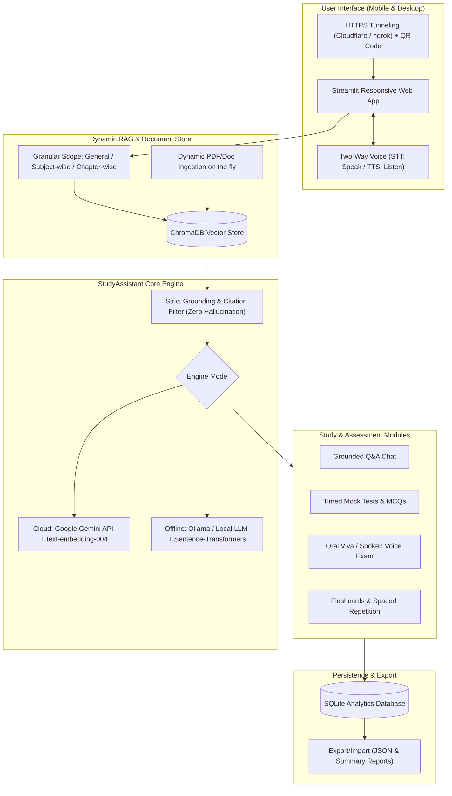

# StudyAssistant: Comprehensive Architecture & Implementation Plan

## Overview
StudyAssistant is a multi-feature, voice-enabled Retrieval-Augmented Generation (RAG) study tutor and assessment application tailored for insurance exam preparation (Engineering, Fire, Motor, and custom subjects). It runs as a responsive Streamlit web app supporting both mobile and desktop, with zero-hallucination document grounding, two-way voice communication, dual AI engines (Cloud Gemini & Offline Local LLM), and persistent performance analytics.

---

## Architecture Blueprint

---

## Detailed Specifications

### 1. Dual AI Engine & Vector Store
- **Cloud Mode**: Google Gemini models (`gemini-2.5-flash` or `gemini-1.5-flash`) + Google `text-embedding-004`. Fast, accurate, handles large context windows.
- **Offline / Local Mode**: Ollama / local LLM (e.g. Llama 3 / Mistral) + local embeddings (`sentence-transformers/all-MiniLM-L6-v2`). Runs 100% disconnected.
- **Vector Database**: ChromaDB with separate collections or metadata tags for subjects and chapters.
- **Strict Grounding Guard**: Enforces zero hallucination by refusing out-of-document claims unless "allow external knowledge" is explicitly toggled by the user. Every answer requires verifiable document citations (file name, section, page).

### 2. Knowledge Base & Granular Scoping
- Pre-indexes the demo insurance exam materials:
  - `ENGG_Study_Material_Fast_Revision.pdf` (Engineering Insurance)
  - `Fire tariff.pdf` (Fire Tariff Guidelines & Rules)
  - `FIRE_Study_Material.pdf` (Fire Insurance Study Material)
  - `UPDATED_MOTOR_WRITE_UP_FOR_PE_2026_27_EXAMINATION_ON_27_12_2025.pdf` (Motor Insurance for PE 2026-27)
- Dynamic upload widget to ingest and parse new PDF/DOCX documents on the fly.
- Granular scope selector:
  - **General**: Queries and tests span all uploaded materials.
  - **Subject-wise**: Filtered to a specific subject (Fire, Motor, Engineering, etc.).
  - **Chapter/Topic-wise**: Filtered to extracted sub-topics or chapters.

### 3. Two-Way Voice Communication
- **Voice Input (STT)**: User speaks questions or oral answers. Employs browser Web Speech API with fallback to audio recording (MediaRecorder) transcribed by Gemini multimodal audio or Whisper.
- **Voice Output (TTS)**: Agent articulates answers, quiz questions, and oral viva prompts aloud using browser speech synthesis with customizable pitch, speed, and volume.
- Seamless instant toggling between voice and text.

### 4. Study & Assessment Modes
- **Grounded Q&A Chat**: Interactive conversational study partner with sidebar reference viewer and citations.
- **Timed MCQ Mock Tests**: Practice tests with configurable question counts, subjects, countdown timers, instant explanations, and scoring.
- **Oral Viva / Spoken Exam**: Examiner mode where AI asks spoken questions, records and listens to student's spoken answers, evaluates conceptual accuracy, highlights missing key points, and assigns scores.
- **Flashcards & Quick Drills**: Spaced repetition style flip cards to drill formulas, tariff rules, and key definitions.

### 5. Persistence, Analytics & Mobile Access
- **SQLite Database**: Automatically logs quiz scores, timestamps, subject breakdown, weak topics, and flashcard mastery across sessions.
- **Analytics Dashboard**: Visual charts showing progress, accuracy by subject, and recommended revision topics.
- **Export/Import**: JSON backup/restore and downloadable Markdown/PDF performance reports.
- **Mobile Experience**: Responsive UI, local Wi-Fi QR code generator, and optional HTTPS tunneling (localtunnel / Cloudflare tunnel) for remote phone access with microphone permissions.
